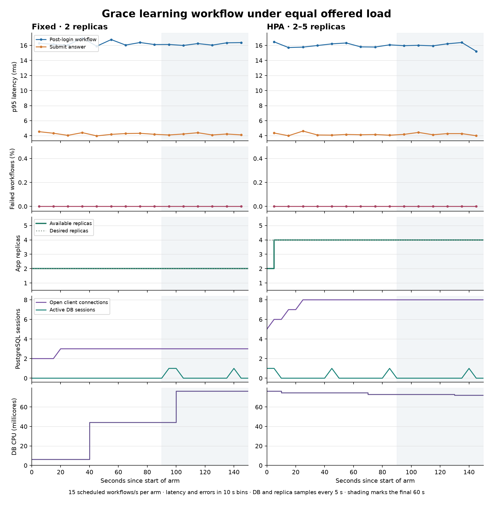

# Does HPA improve the Grace learning workflow?

## Measured comparison

Both arms ran for 150 seconds on the same two-node minikube cluster. The client scheduled 15 short learning sessions per second, staggered across ten dedicated accounts. Each session logged in, listed papers, opened a private fixture, submitted a choice answer, saved the next question, reopened the paper to verify the grade and position, then logged out. Counting the home page and all assets was outside the timing scope. HTTP timing includes the laptop port-forward and Caddy. The post-login and answer timings exclude authentication.

| Measurement | Fixed at 2 | HPA 2–5 |
| --- | ---: | ---: |
| Offered workflows per second | 15 | 15 |
| Started workflows (150 s) | 2250 | 2250 |
| Missed scheduled starts | 0 | 0 |
| Failed workflows | 0 | 0 |
| HTTP requests including logout | 15750 | 15750 |
| Available replicas, final 60 s | 2 | 4 |
| Login through restored position, p95 (ms), final 60 s | 34.92 | 34.81 |
| Post-login practice, p95 (ms), final 60 s | 16.24 | 15.99 |
| Answer submission, p95 (ms), final 60 s | 4.19 | 4.2 |
| Peak sampled DB client connections | 3 | 8 |
| Peak sampled active DB sessions | 1 | 1 |
| Peak sampled DB CPU (millicores) | 76.18 | 76.18 |
| DB transactions/s over the full arm | 481.7 | 479.3 |
| Peak sampled sessions waiting on locks | 0 | 0 |
| New database deadlocks | 0 | 0 |

The HPA arm first observed each available replica count at these elapsed times: 2 at 0 s, 4 at 5 s. In the final matched minute, the post-login p95 changed by -1.5% and the answer p95 by +0.2%. There were 900 and 900 measured sessions in those windows.

The configured PostgreSQL connection limit was 100. The monitoring connection is excluded from the counts. Active sessions and lock waits were sampled every five seconds and can miss short waits. CPU values come from metrics-server's rolling sample windows; the two arms observed 3 and 4 distinct DB CPU timestamps. Database transaction counters cover the whole database, including the observer. PostgreSQL stayed up throughout both arms.

## Interpretation

Four available Grace Pods served the same 15 workflows/s as two. The final-minute post-login p95 was 0.25 ms lower with four Pods. Answer submission differed by 0.01 ms and both groups completed every workflow. This run shows little user-visible latency benefit at this rate. Peak observed PostgreSQL client connections rose from 3 to 8 out of 100, while peak sampled active sessions stayed at one. Neither arm recorded a deadlock or sampled a lock wait. The extra connections did not coincide with a visible database bottleneck.

This single fixed-first, HPA-second run measures the effect at one offered rate on local hardware. The HPA inherited a warm database and CPU metrics from the fixed arm. The final minute compares the same point in each arm; the full timeline includes scale-up. The load was staggered, each account had at most one workflow in flight, and each short session performed a fresh password check. A lower error rate cannot be inferred when both arms record zero errors. Production latency, overload behaviour and maximum database-supported throughput require separate measurements.

[Raw observations and summaries](practice-hpa.json) · [Reproduction script](../../scripts/compare-practice-hpa.py)

For a repeat run, forward the local `grace-dash-demo` Caddy Service to `127.0.0.1:18090` with `kubectl --context grace-dash-demo -n grace port-forward --address=127.0.0.1 svc/caddy 18090:8090`. Export `GRACE_DEMO_ACCOUNTS` for the ten rehearsal accounts and run `python3 scripts/compare-practice-hpa.py /tmp/practice-hpa.json` from the repository root. Leave the synthetic CPU test idle. The script temporarily caps HPA at two for the first arm and restores its original ceiling of five before the second arm. It reuses one clearly named test paper per account.
