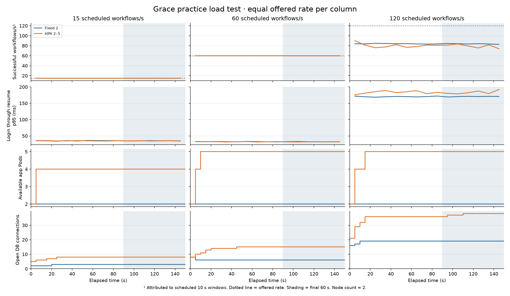

# Grace practice under increasing load

Both configurations sustained 60 workflows/s. At 120 scheduled workflows/s, fixed replicas completed 83.75/s and HPA completed 79.89/s. HPA reached five available Pods by the 15-second sample. The final-minute answer p95 increased from 68.05 to 72.37 ms. Sampled peak DB connections doubled from 19 to 38, with at most three active sessions and no observed lock waits. This run shows no workflow improvement from HPA at the higher rate. It does not locate the limiting component or measure maximum database capacity.

Ten dedicated accounts repeatedly logged in, listed their papers, opened a private test paper, submitted an answer, saved their position, reopened the paper to verify the saved state, and logged out. Each load level had a 150-second fixed-2 arm followed by a 150-second HPA arm on the same two-node minikube cluster. HPA could use 2–5 application Pods. The 15/s rows come from the earlier baseline.

| Offered workflows/s | Policy | Available Pods, final minute | Successful / scheduled | Successful/s | Skipped starts | Failed / started | Login through resume p95 (ms) | Post-login p95 (ms) | Submit p95 (ms) |
|---:|---|---:|---:|---:|---:|---:|---:|---:|---:|
| 15 | Fixed | 2 | 2,250 / 2,250 | 15.00 | 0 | 0.00% | 34.92 | 16.24 | 4.19 |
| 15 | HPA | 4 | 2,250 / 2,250 | 15.00 | 0 | 0.00% | 34.81 | 15.99 | 4.20 |
| 60 | Fixed | 2 | 9,000 / 9,000 | 59.99 | 0 | 0.00% | 32.21 | 15.48 | 3.78 |
| 60 | HPA | 5 | 9,000 / 9,000 | 59.99 | 0 | 0.00% | 31.89 | 15.28 | 3.69 |
| 120 | Fixed | 2 | 12,571 / 18,000 | 83.75 | 5,429 | 0.00% | 170.60 | 90.06 | 68.05 |
| 120 | HPA | 5 | 11,990 / 18,000 | 79.89 | 6,010 | 0.00% | 183.91 | 95.73 | 72.37 |

The counts and throughput cover each entire arm. Latencies cover workflows scheduled in the final minute and measure time from the actual start, excluding client scheduling delay. A skipped start means the account was occupied for more than one scheduling interval. Each account runs one workflow at a time. Successful/s uses elapsed time through the last completed workflow (nominal 150 seconds for the earlier 15/s baseline). Each workflow has seven HTTP operations including logout.

| Offered workflows/s | Policy | Peak DB clients (limit 100) | Peak active | Peak waiting for locks | New deadlocks | Peak DB CPU (millicores) | DB transactions/s |
|---:|---|---:|---:|---:|---:|---:|---:|
| 15 | Fixed | 3 | 1 | 0 | 0 | 76 | 482 |
| 15 | HPA | 8 | 1 | 0 | 0 | 76 | 479 |
| 60 | Fixed | 8 | 1 | 0 | 0 | 262 | 1915 |
| 60 | HPA | 15 | 1 | 0 | 0 | 262 | 1913 |
| 120 | Fixed | 19 | 2 | 0 | 0 | 552 | 2676 |
| 120 | HPA | 38 | 3 | 0 | 0 | 552 | 2549 |

PostgreSQL connection and lock readings were sampled every five seconds and exclude the observer connection from open and active counts. CPU comes from metrics-server rolling windows. Transaction counts cover the whole database. Fixed-first order, shared local hardware, the port-forward, and the ten-client concurrency limit all affect the measurements. At saturation the two arms can receive different numbers of workflows despite equal scheduled demand.

[15/s observations](practice-hpa.json) · [60/s observations](practice-hpa-60.json) · [120/s observations](practice-hpa-120.json)

To repeat, follow the [local baseline setup](practice-hpa.md), then use the same script with `--rate 60` or `--rate 120` and a fresh output path.
