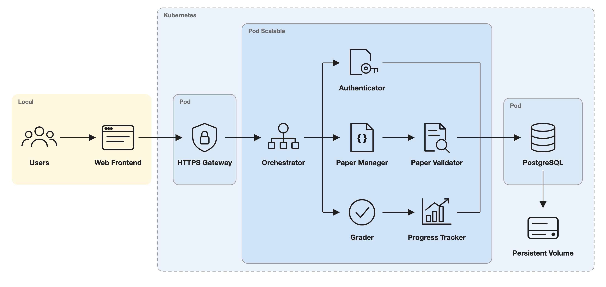
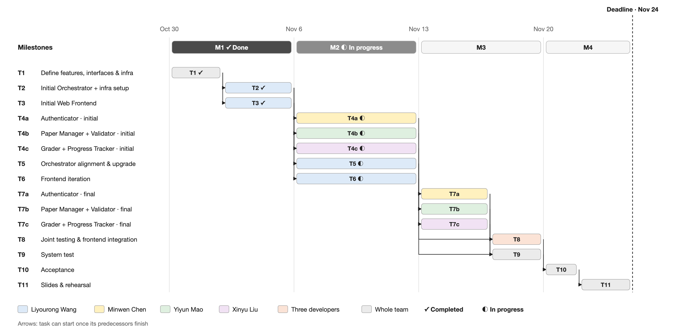
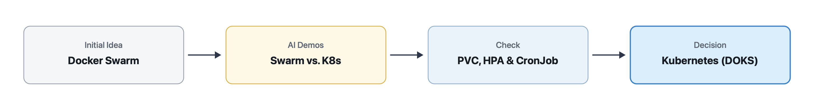

# Grace — Project Proposal

## 1. Motivation

### 1.1 Problem Statement and Significance

Language learners frequently pursue specific objectives using their own custom materials, such as preparing for certification exams or acquiring native expressions. Pre-built question banks typically follow a generic curriculum and do not address these individualized needs. Even when exercises are available, learners must still verify responses and track completed questions. When practice occurs in short sessions, returning to the material often requires reviewing previous work, identifying unanswered questions, and determining where to resume. Repeating this process leaves less time for practice. Therefore, Grace is designed to keep answers and progress with the exercises so learners can pick up where they left off.

### 1.2 Intended Users and Stakeholders

The target users are language learners who possess customized exercises and seek to practice these materials over multiple sessions. A student revisiting French-class mistakes may complete only part of a practice set during a short study break. At the next session, they need to distinguish unpracticed questions from completed ones and review their previous answers manually. Grace keeps their exercises, submitted answers, and progress together across sessions and devices.

### 1.3 Limitations of Existing Solutions

Existing platforms such as Duolingo offer structured lessons, but their practice activities are limited to pre-defined content. This structure may not align with learners’ specific classroom materials or personal error logs. Anki provides more flexibility in content creation, but its standard typed-answer feature requires learners to self-assess recall accuracy. Grace focuses on completing a learner’s own practice set over several sessions, checking submitted answers against a prepared key and keeping a record of completed and unanswered questions.

## 2. Objectives, Architecture, and Key Features

### 2.1 Main Objectives and Core Functionality

The main objective is to build a cloud service that helps language learners practice with their own prepared exercises and reference answers, receive immediate feedback, and resume their progress across sessions and devices.

The core functionalities include user registration and authentication, JSON paper uploads, grading, and persistent storage of answers and progress for resuming practice across sessions and devices.

### 2.2 Assumptions
The whole project is under the assumption that users access the service through a web browser and they are geographically concentrated. The proposed capacity upper limit is 100 registered users and 20 concurrently active learners. 

### 2.3 Planned system architecture and rationales

As shown in Figure 1 below, users primarily interact with the Web Frontend, sending requests through the HTTPS Gateway to the Orchestrator for routing to application modules. The Authenticator verifies user identity by comparing the credentials provided by users against stored data. The Paper Manager calls the Paper Validator to check uploaded papers against the required JSON schema. The Grader checks submitted answers against the paper’s reference key, while the Progress Tracker saves practice progress. Each submission will be stored as an attempt, with a separate progress record identifying the learner’s current position. These modules share a PostgreSQL database allowing users to resume their work across sessions and devices.

*Figure 1. Grace system architecture*

The yellow `Local` area represents browser-based interaction on users' devices, while the blue `Kubernetes` area contains the server-side workloads for keeping authoritative state on the server. The gateway, application, and PostgreSQL run in separate `Pods` to separate their lifecycles and scaling requirements. This separation allows application replicas to scale without coupling lifecycles to the database.

Within the `Pod Scalable` boundary, the business logic is organized into separate functional modules. This reduces integration and deployment overhead at the cost of releasing and scaling all modules together.

All application replicas share PostgreSQL-backed sessions and practice records, allowing requests to reach any replica without relying on replica-local state. PostgreSQL therefore uses a Persistent Volume whose lifecycle is separate from the database Pod, allowing replacement Pods to reuse existing records.

### 2.4 Alternative Design, Tradeoffs and Risks

Docker Swarm was considered because it reuses our Compose-based environment without a full Kubernetes cluster. 

We selected Kubernetes because we judge the benefits of HPA and PVCs, plus CronJobs for stretch backups, to be worth the additional setup and operational work compared with a simpler Swarm deployment. The tradeoff is greater configuration and troubleshooting effort for a relatively small service. Section 4.2 compares Swarm and Kubernetes.

There is also a risk that scaling application replicas may increase pressure on the shared PostgreSQL database. We will use load testing to set replica limits the database can support.

### 2.5 Required course technologies

- `Docker and Docker Compose`: Docker will package the application and PostgreSQL as separate containers. Docker Compose will provide a consistent local development and integration-testing environment.

- `PostgreSQL and persistent storage`: PostgreSQL will store accounts, sessions, papers, questions, submitted answers, and practice progress. Docker named volumes will preserve local data, while a Kubernetes PersistentVolumeClaim backed by DigitalOcean block storage will preserve cloud database files across Pod replacement.

- `Deployment provider`: DigitalOcean provides a cloud platform, integrating managed cluster infrastructure with provider networking, storage, and monitoring.

- `Orchestration`: Kubernetes was selected as the orchestration approach. We will use minikube for local development and DigitalOcean Kubernetes for production deployment.

- `Monitoring and observability`: DigitalOcean alerts will notify the team when node CPU or disk usage exceeds 80%, and a kube-state-metrics dashboard will show pod restarts and failed readiness checks. Structured logs and liveness/readiness endpoints distinguish a running process from an application able to reach its database.

- `Auto-scaling and high availability (advanced feature 1)`: A HorizontalPodAutoscaler will scale the stateless application Deployment from 2 replicas to a load-tested maximum, at 70% average CPU. Load tests above 20 users will confirm scale-out and find the database's replica limit. PostgreSQL runs as a single replica on its PVC, so high availability covers only the application tier.

- `CI/CD pipeline (advanced feature 2)`: GitHub Actions will run module tests and build images on each pull request. After end-to-end checks pass, a merge to `dev` will deploy to DigitalOcean Kubernetes.

### 2.6 Scope and feasibility

The scope of the project is a single-region, stateful language-practice service for an initially small, geographically concentrated user base. Delivery covers the complete workflow from account creation and custom paper upload to grading and saved-progress recovery. We commit to two advanced features, auto-scaling/high availability and CI/CD, and will add backup if time allows.

The feasibility of the project is supported by the following:

- We have deployed an MVP on DigitalOcean that provides a foundation for all future development.

- Three feature owners can develop accounts, papers, and practice in parallel, while the system architect establishes the shared framework, API contracts, and data structures to reduce blocking dependencies.

- Weekly Friday team meetings will support coordination, with task delegation illustrated in the following section.

## 3. Project Plan and Team Responsibilities

### 3.1 Team Members' Responsibilities & Roles

| Team Member | Responsibilities |
| --- | --- |
| Developer — Minwen Chen | <ul><li>Authenticator: accounts, authentication, and access control</li></ul> |
| Developer — Xinyu Liu | <ul><li>Grader and Progress Tracker: practice interactions, answer evaluation, attempt history, and progress recovery</li></ul> |
| Developer — Yiyun Mao | <ul><li>Paper Manager and Paper Validator: custom paper and question validation, upload, storage, and management</li></ul> |
| Architect — Liyourong Wang | <ul><li>Lead architecture and maintain the Orchestrator and shared application backbone</li><li>Coordinate schemas and API contracts</li><li>Own cloud and database DevOps, including Kubernetes deployment and PostgreSQL operations</li></ul> |

Each developer will write module tests and resolve integration issues.

### 3.2 Major stages of development

*Figure 2. Grace development schedule and task dependencies*

Starting from the MVP, iterations will combine parallel development, integration demonstrations, and backlog reviews.

- **M1 — Foundation:** Define features and interfaces, and complete the initial full-stack development.
- **M2 — Initial module development:** Develop modules in parallel and begin interface checks.
- **M3 — Module finalization and testing:** Finalize functional modules, then conduct joint testing, frontend integration, and system testing.
- **M4 — Acceptance and presentation preparation:** Complete acceptance testing, followed by slide preparation and presentation rehearsal.

### 3.3 Team Development and Integration Strategy
1. **Dependencies and interface agreements.** We will identify module dependencies while agreeing on request formats before parallel development.

2. **Branch development and CI/CD.** Developers will create task branches from `dev` and submit PRs for review. A CI/CD pipeline will automate builds, tests, and deployments. PRs will be merged into `dev` after review and successful checks. End-to-end tests will cover registration, private paper upload, answer feedback, progress recovery, and cross-user data isolation in Docker Compose and on DigitalOcean Kubernetes.

3. **Progress sharing and task management.** Team members will share progress and blockers through GitHub Discussions. GitHub Issues will track tasks and blockers.

| Risk | Description | Mitigation |
| --- | --- | --- |
| **System Architect bottleneck** | Concentrated architecture responsibilities could delay dependent tasks. | Liyourong will provide shared capabilities before dependent development begins. Teammates will track blockers in Issues and coordinate integration fixes. |
| **Module interface dependencies** | Paper management and practice rely on shared authentication. | Use agreed interfaces and notify affected developers of changes through Issues. |
| **Integration delays** | Integration delays could compress M4 acceptance and rehearsal time. | Start integration checks in M2 and prioritize blocker fixes during M3 validation. |

## 4. Initial Team Reasoning and AI-Assisted Exploration

### 4.1 Initial Team Reasoning

Our initial idea for Grace came from a practical limitation in existing language learning apps mentioned in previous sections. We want a cloud service where users practice their custom language exercises.

We formed two technical hypotheses initially. First, we defined a JSON schema so users could write exercises externally. Second, as our MVP already ran on Docker Compose, we assumed Docker Swarm would be the orchestration choice since it reuses Compose configuration.

We also proposed an open question to investigate:
- Which is more practical on DigitalOcean once we add persistent PostgreSQL storage, auto-scaling, and scheduled backups, Docker Swarm or Kubernetes?

### 4.2 Exploration and Evaluation

We checked these assumptions through team discussion, local MVP testing, and AI-assisted demos. Tests of our local Docker Compose + PostgreSQL setup confirmed that a mounted volume keeps user records across container restarts.

For cloud-orchestration-platform decisions, we asked AI to build demos for both Docker Swarm and Kubernetes and compared how they perform:

*Figure 3. Orchestration platform evaluation and decision flow*

| Dimension | AI Demo A: Docker Swarm | AI Demo B: Kubernetes (`minikube` / DOKS) |
| :--- | :--- | :--- |
| **Initial Setup** | Directly reuses `docker-compose.yml` | More YAML upfront (`Deployment`, `Service`, `PVC`) |
| **PostgreSQL Storage** | Must pin DB to one node (`node.role == manager`) or a rescheduled container mounts an empty local disk | Reattaches volumes across pod restarts using `do-block-storage` CSI and `PersistentVolumeClaims` |
| **Auto-Scaling** | No built-in auto-scaler; needs custom scripts calling `docker service scale` | Built-in CPU/memory scaling via `HorizontalPodAutoscaler` |
| **Backups** | Host crontab tied to one machine | Cluster `CronJob` and `Secret` running `pg_dump` |

Although AI highlighted Swarm's quick setup, comparing both demos showed that Swarm creates maintenance issues for volume failover and scaling. We dropped the Swarm idea and chose Kubernetes (`minikube` locally, then DigitalOcean Kubernetes) because the extra YAML setup upfront saves us from writing custom workarounds for autoscaling, volume failover, and scheduled backups.

## 5. Conclusion

With an existing MVP, clear team responsibilities, and a staged development plan, we can deliver Grace within the proposed timeline.
