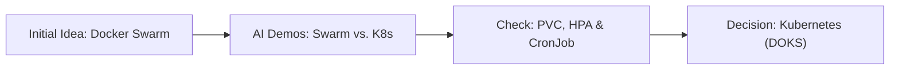

# Grace: Project Proposal

## 1. Motivation

### 1.1 Problem Statement and Significance

Nowadays, self-paced study is a common need among language learners. For a language like French, learners have different goals, such as preparing for certification exams, practising workplace expressions, or reviewing class mistakes. However, pre-built question banks follow a generic curriculum and cannot cover these individual needs. Learners instead want to build practice material from class notes, textbooks, or their own error logs so they control the content. Even when questions and reference answers are ready, learners still have to organize the questions, check answers against references, and track what they have mastered. When study happens in short breaks, returning to a set means reviewing old work, finding unanswered questions, and figuring out where to resume, leaving less time for practice. Grace closes this gap between what learners want to study and what they can practice by keeping exercises, answers, and progress together.

### 1.2 Intended Users and Stakeholders

Our initial users are language learners who have custom exercises and reference answers and want to practice them over several short sessions. For example, a student reviewing French class mistakes may finish only part of a practice set during a short break. Next time, they have to tell unpracticed questions apart from completed ones and recover their previous work by hand. Grace keeps their exercises, answers, and progress together across sessions and devices so they can pick up where they left off.

### 1.3 Limitations of Existing Solutions

Existing apps such as Duolingo offer structured lessons, but their practice is limited to pre-made content and does not match a learner's class notes or error logs. Anki gives more flexibility in content creation, yet its typed-answer mode still asks learners to judge their own recall accuracy. Meanwhile, notebooks and spreadsheets give full flexibility, but provide no answer checking, feedback loop, or progress tracking. Grace combines the strengths of both in a simple workspace for multiple-choice, translation, and sentence-construction questions where users bring their own content and the system handles grading, feedback, and record-keeping. Uploaded materials stay private by default.

## 2. Objectives, Architecture, and Key Features

### 2.1 Main Objectives and Core Functionality

Our main objective is to build a cloud service that helps language learners practice with their own prepared exercises and reference answers, get immediate feedback, and resume progress across sessions and devices.

Core functionality covers user registration and login, custom JSON paper uploads, immediate grading and feedback, and persistent storage of answers and progress.

### 2.2 Assumptions

We assume that users access Grace through a web browser over the internet and are mostly in the same region. The target capacity limit is 100 registered users and 20 concurrent active learners.

### 2.3 Planned System Architecture and Rationales

As shown in Figure 1, users interact with the Web Frontend in their browser, sending requests through the HTTPS Gateway to the Orchestrator for routing to backend modules. The Authenticator checks login credentials against stored data. The Paper Manager calls the Paper Validator to check whether uploaded papers follow the JSON schema. The Grader checks submitted answers against the paper's reference key, while the Progress Tracker saves the latest answers and current progress to the database. All modules share a PostgreSQL database so users can resume work across sessions and devices.

*Figure 1. Grace system architecture*

In Figure 1, the yellow `Local` area shows browser interactions on the user's device, while the blue `Kubernetes` area holds the server-side workloads that keep state on the server. The gateway, application, and PostgreSQL run in separate `Pods` because they have different roles. Separating them lets app replicas scale without tying their lifecycle to the database.

Inside the `Pod Scalable` boundary, business logic is organized into separate functional modules within one service. This keeps integration and deployment simple for our team, at the cost of releasing and scaling all modules together.

Because all application replicas share sessions and practice records in PostgreSQL, requests can reach any replica without relying on local memory. PostgreSQL uses a Persistent Volume whose lifecycle is separate from the database pod, so replacement pods can reuse existing records after a restart.

### 2.4 Alternative Design, Tradeoffs, and Risks

We initially considered Docker Swarm because it offers a simpler transition from our Docker Compose setup without the complexity of managing a Kubernetes cluster.

We selected Kubernetes because built-in features like HPA, PVCs, and CronJobs are worth the extra setup compared with a simpler Swarm deployment. The tradeoff is more configuration and troubleshooting effort for a small service. Section 4.2 covers our comparison between Docker Swarm and Kubernetes in detail.

One risk is that scaling application replicas may increase pressure on the shared PostgreSQL database. We will use load testing to set replica limits that the database can support.

### 2.5 Required Course Technologies

- `Docker and Docker Compose`: Docker packages the app and PostgreSQL as separate containers, and Docker Compose gives the team a consistent local environment for development and testing.
- `PostgreSQL and persistent storage`: PostgreSQL stores user accounts, papers, and practice history. Local volumes and Kubernetes PVCs keep database files intact across container replacement.
- `Deployment provider`: DigitalOcean hosts our deployment, combining a managed cluster with provider networking, storage, and monitoring.
- `Orchestration`: We use Kubernetes for orchestration, with `minikube` locally and DigitalOcean Kubernetes in production.
- `Monitoring and observability`: DigitalOcean metrics and alerts, `kube-state-metrics`, external HTTPS checks, and structured logs expose resource pressure and failures. Liveness and readiness probes distinguish a running process from an app able to reach its database.
- `Auto-scaling and high availability`: We use Kubernetes pod autoscaling and multiple app replicas to handle changing demand and single-pod failures.
- `Security enhancements`: We use HTTPS, user-level access controls, and deployment secrets to protect data in transit, keep papers private, and keep credentials outside Git.
- `CI/CD pipeline`: We automate tests, image builds, and deployments in GitHub Actions, with manual approval for production releases.
- `Backup and recovery`: We schedule PostgreSQL backups to separate storage and test restoration so we have a verified recovery path beyond persistent volumes.

### 2.6 Scope and Feasibility

The scope is a single-region, stateful language-practice service for a small, geographically concentrated user base, covering account creation, custom paper upload, grading, and progress recovery.

Three factors support our feasibility:
- We completed a DigitalOcean-deployed MVP as our foundation.
- Three developers can build accounts, papers, and practice in parallel while the architect maintains the shared framework, API contracts, and schemas.
- Weekly Friday meetings support coordination, with tasks organized in Section 3.

## 3. Project Plan and Team Responsibilities

### 3.1 Team Members' Responsibilities and Roles

| Team Member | Responsibilities |
| --- | --- |
| Developer: Minwen Chen | <ul><li>Authenticator: accounts, authentication, and access control</li><li>Resolve integration issues</li></ul> |
| Developer: Xinyu Liu | <ul><li>Grader and Progress Tracker: practice interactions, answer evaluation, attempt history, and progress recovery</li></ul> |
| Developer: Yiyun Mao | <ul><li>Paper Manager and Paper Validator: custom paper and question validation, upload, storage, and management</li></ul> |
| System Architect: Liyourong Wang | <ul><li>Maintain the Orchestrator and shared application backbone</li><li>Coordinate schemas and API contracts</li><li>Own cloud and database DevOps, including Kubernetes deployment and PostgreSQL operations</li></ul> |

### 3.2 Major Stages of Development

*Figure 2. Grace development schedule and task dependencies*

As shown in Figure 2, we will complete four milestones:
- **M1 (Foundation):** Define features and interfaces, and finish the initial full-stack MVP. Completed ahead of schedule.
- **M2 (Initial module development):** Build the draft submodules in parallel. Currently in progress.
- **M3 (Module finalisation and testing):** Finish functional modules, then run joint testing, frontend integration, and system testing.
- **M4 (Acceptance and presentation preparation):** Complete acceptance testing, prepare slides, and rehearse the presentation.

### 3.3 Team Development and Integration Strategy

1. **Dependencies and interface agreements:** We identify module dependencies and agree on request formats before parallel development.
2. **Branch development and CI/CD:** Developers create task branches from `dev` and submit PRs for review. Our CI/CD pipeline automates builds, tests, and deployments, and PRs merge into `dev` after passing checks.
3. **Progress sharing and task management:** Team members share progress and blockers in GitHub Discussions, and we use GitHub Issues to assign and track tasks.

| Risk | Description | Mitigation |
| --- | --- | --- |
| **R1: System Architect bottleneck** | Concentrated architecture work on one person could delay dependent tasks. | Flag blockers early in Issues and arrange help promptly. |
| **R2: Module interface dependencies** | Paper management and practice rely on shared authentication and paper interfaces. | Follow agreed interfaces and notify affected developers through Issues. |
| **R3: Integration delays** | Late integration failures could squeeze M4 acceptance and rehearsal time. | Start integration checks in M2 and fix blocking bugs first in M3. |

## 4. Initial Team Reasoning and AI-Assisted Exploration

### 4.1 Initial Team Reasoning

Our initial idea for Grace started from the problem in Section 1: learners often want to practice from their own notes or error logs rather than a fixed curriculum, yet checking answers and tracking unfinished questions by hand is tedious. We wanted a simple workspace where users upload their own exercises, get instant feedback, and resume where they left off.

Before using AI for system design, we formed two initial hypotheses. First, to avoid spending weeks on a complicated frontend editor, we defined a JSON schema so users could write exercises externally or ask AI to turn their notes into JSON for upload. Second, because our MVP already ran on Docker Compose with PostgreSQL, we assumed Docker Swarm would be the easiest orchestration choice since it reuses Compose files.

We also had an open question to investigate: on DigitalOcean, is Docker Swarm or Kubernetes more practical once we add persistent PostgreSQL storage, auto-scaling, and scheduled backups?

### 4.2 Exploration and Evaluation

We checked these early ideas through team discussions, reading the handout, local MVP testing, and AI-assisted demos. The handout confirmed that grading focuses on backend architecture rather than UI complexity (supporting our JSON upload choice), and that managed databases do not count toward persistent storage. In our local Docker Compose setup, we also tested container restarts to confirm that a mounted volume keeps user records intact.

To decide between Docker Swarm and Kubernetes, we asked AI to build demos for both options and compared how they handle our planned features:

| Dimension | AI Demo A: Docker Swarm | AI Demo B: Kubernetes (`minikube` / DOKS) |
| :--- | :--- | :--- |
| **Initial Setup** | Directly reuses `docker-compose.yml` | More YAML upfront (`Deployment`, `Service`, `PVC`) |
| **PostgreSQL Storage** | Must pin DB to one node (`node.role == manager`) or a rescheduled container mounts an empty disk | Reattaches volumes across pod restarts via `do-block-storage` CSI and `PersistentVolumeClaims` |
| **Auto-Scaling** | No built-in auto-scaler; needs custom scripts calling `docker service scale` | Built-in CPU/memory scaling via `HorizontalPodAutoscaler` |
| **Backups** | Host crontab tied to one machine | Cluster `CronJob` and `Secret` running `pg_dump` |

At first, the AI's Swarm demo looked appealing because it was quick to set up. However, when we looked closely at how both demos handled restarts and scaling, we saw that Swarm had to pin PostgreSQL to one node to avoid mounting an empty disk after rescheduling, and needed custom scripts for auto-scaling. While Kubernetes required more YAML upfront, DigitalOcean Kubernetes gave us built-in primitives (`PVCs`, `HPA`, and `CronJobs`) for the advanced features we planned to build. Based on that comparison, we dropped Swarm and chose Kubernetes.

## 5. Conclusion

With an existing MVP, clear team responsibilities, and a staged plan, we are confident we can deliver Grace within the timeline.
